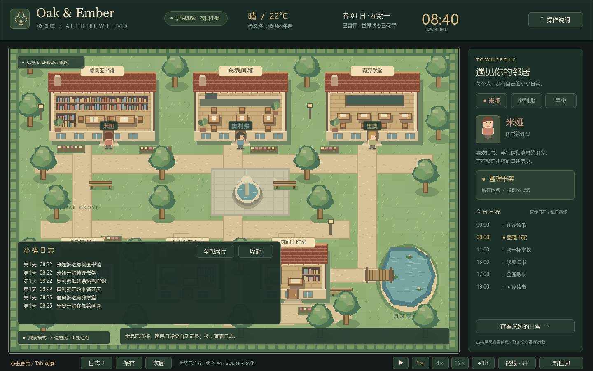

# 橡树镇 · Oak & Ember

Godot 像素校园小镇，当前版本 **v0.2.0：NPC 观察与统一模拟**。



小镇只有米娅、奥利弗、里奥 3 位 NPC，没有主角或玩家移动。可以观察他们按固定日程活动，查看每位角色的日常日志，保存并恢复完整世界。

## 启动

需要 **Godot 4.7 标准版**和 **Python 3.10+**。Python 服务只使用标准库，不需要安装第三方包，不依赖 .NET 或外部 AI 服务。

- Windows 双击 `launch.bat`，或在 Godot 中打开 `project.godot` 后按 F5。
- 首次运行自动启动本地世界服务，之后自动恢复 SQLite 中最后提交的世界。关闭窗口会结束由该窗口自动启动的服务；独立启动的服务不受影响。
- 当前电脑自动识别 `D:/Godot` 和 `D:/Anaconda3/python.exe`。其他电脑可设置 `TOWN_PYTHON` 指定 Python，或使用：

```powershell
.\launch.ps1 -GodotPath 'C:\Tools\Godot.exe' -PythonPath 'C:\Python312\python.exe'
```

也可单独运行后端，再打开 Godot：

```powershell
python backend/server.py
# 启动时暂停实时驱动
python backend/server.py --paused
```

默认 API 为 `http://127.0.0.1:8765`，数据库为项目内 `.runtime/town.sqlite3`。数据不提交到 Git。自动启动时可用 `TOWN_DB_PATH` 指定其他数据库；独立启动服务可使用 `--db` 和 `--port`，当前 Godot 界面连接默认 8765 端口。

## 界面操作

| 操作 | 功能 |
| --- | --- |
| 点击 NPC / 右侧名字 / Tab | 查看角色简介、当前活动、目的地和固定日程 |
| 查看某角色的日常 | 打开该角色的事件日志 |
| J / 日志按钮 | 展开或收起日志；日志内可切换全部 / 单个角色 |
| 空格 / 暂停 | 暂停或继续统一世界时钟 |
| 1× / 4× / 12× | 调整实时模拟速度 |
| +1h | 实际模拟一小时，保留途中的全部活动与事件 |
| R | 显示或隐藏 NPC 行走路线 |
| 保存 | 创建完整世界快照 |
| 恢复 | 恢复最新手动快照，NPC 从原位置、原路线继续 |
| 新世界 | 新建第 1 天 07:50 的世界，保留旧世界日志及历史存档 |

日志面板显示最近 6 条，完整历史保存在数据库，可通过 API 按角色、日期、游标分页读取。建筑内部为剖面展示，NPC 活动点位于门前。

## 统一时间和世界状态

- 模拟核心为 `backend/simulation.py`，不依赖 Godot、显示窗口、HTTP 或数据库。
- `data/town.json` 是地图、碰撞、地点、NPC 资料和日程的共同定义；Godot 与后端读取同一份配置。
- 统一时钟使用整数 tick，每步 30 游戏秒，一天 2880 步；1× 时现实 1 秒推进 2 游戏分钟。
- 时钟、移动、日程切换和事件使用同一个固定步长。批量模拟与逐步模拟结果一致。实时驱动使用单调时钟；关闭服务期间世界不会自行推进。
- Godot 只是 API 的观察界面，不持有独立模拟时钟，不直接修改角色位置，也不写数据库。世界信息还包含天气、时段和各地点的已抵达角色。
- 所有推进均沿四邻域寻路逐段移动，不会瞬移；+1h 和无界面一天模拟也不会跳过中间任务。

## 无界面验收：模拟一天并恢复存档

以下命令完全不启动 Godot，也不打开窗口。请停止使用同一个数据库的服务，或使用独立验收数据库；数据库有单进程写入保护。

```powershell
# 从新数据库的 07:50 起推进完整 24 小时，保存快照；输出 snapshot_id 和完整世界
python backend/cli.py simulate-day --db .runtime/acceptance.sqlite3 --name 第一天验收

# 在另一个进程中再推进一天
python backend/cli.py simulate-day --db .runtime/acceptance.sqlite3 --name 第二天验收

# 恢复第一次保存的快照
python backend/cli.py restore --db .runtime/acceptance.sqlite3 --snapshot-id 1

# 再次启动进程，读取已经恢复的世界
python backend/cli.py state --db .runtime/acceptance.sqlite3
python backend/cli.py snapshots --db .runtime/acceptance.sqlite3
```

恢复内容包括整数时钟、NPC 位置、未完成路线、朝向、动画进度、当前日程、抵达状态、访问计数、暂停和速度。快照恢复会创建新的运行分支、复制存档之前的日志，并增加恢复事件，原运行中存档之后的日志仍然保留。因此运行 ID 和事件序号可能变化，角色行为状态完整恢复。

## API 与数据库

完整接口和请求示例见 [API 文档](docs/API.md)。主要接口：

| 方法 | 路径 | 功能 |
| --- | --- | --- |
| GET | /health | 服务健康与模式版本 |
| GET | /definition | 共同地图、角色与日程定义 |
| GET | /world | 完整世界、时钟、角色、地点占用及最新日志 |
| GET | /npcs、/npcs/mia | 全部或单个角色状态 |
| GET | /events | 按角色、日期、序号分页查询事件 |
| POST | /advance | 明确推进指定游戏分钟，暂停时也可手动推进 |
| POST | /clock | 设置暂停状态或模拟速度 |
| POST | /save、/restore | 创建快照或恢复指定快照 |
| GET | /snapshots | 查看全部存档 |
| POST | /reset | 创建新世界 |

SQLite 表：`world_state`、`events`、`snapshots`。同一事务提交世界与对应事件，使用 WAL、FULL 同步和递增版本号。失败会回滚内存与数据库；服务重启读取最后已提交状态。每个事件有运行 ID、连续序号、游戏时间、角色、事件类型、中文描述和结构化参数。默认仅绑定本机回环地址，不提供公网服务。

## 验证

```powershell
# Python 核心 / SQLite / 真实 HTTP / 独立进程验收
python -m unittest discover -s backend -v

# 首次克隆后先导入资源
& 'D:\Godot\Godot_v4.7.2-stable_win64_console.exe' --headless --path . --editor --import --quit
# Godot 地图与观察界面验证
& 'D:\Godot\Godot_v4.7.2-stable_win64_console.exe' --headless --path . --script tests/test_town.gd
# 实际连接 API 并截图：使用隔离的验收数据库，避免推进日常使用的存档
$env:TOWN_DB_PATH = "$PWD/test-output/preview.sqlite3"
& 'D:\Godot\Godot_v4.7.2-stable_win64_console.exe' --path . -- --smoke-test
```

Python 测试覆盖全天日程与日志、固定步长一致性、路径与避障、半途存档及恢复后结果一致、跨进程恢复、数据库事务回滚、历史日志分页、存档版本错误、HTTP 参数与并发，以及单数据库写入保护。Godot 验证地图连通、无主角、NPC 信息、日志筛选和控制经由共享 API。

## 目录

```text
backend/simulation.py  唯一模拟核心、固定时钟、角色日程和事件
backend/storage.py     SQLite 事务、状态、日志、快照及单写入者锁
backend/server.py      HTTP API 与实时驱动
backend/cli.py         无界面模拟、查询与恢复工具
backend/test_backend.py 后端自动验收
scripts/town.gd        Godot 观察界面、API 客户端、地图绘制
scripts/resident.gd    NPC 只读显示模型
scripts/world.gd       读取共同定义的地图与寻路预览
scenes/town.tscn       主场景
data/town.json         共同地图、碰撞、地点、角色、日程定义
assets/               原创像素素材
tools/generate_art.py  可复现的原始美术生成工具（可选，需要 Pillow）
tests/test_town.gd     Godot 无界面观察界面验证
```

中文版节点总结见 [版本记录](CHANGELOG.md)。代码与原创素材采用 MIT 许可。
